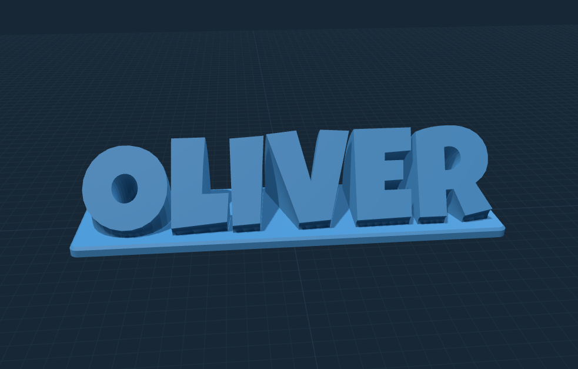
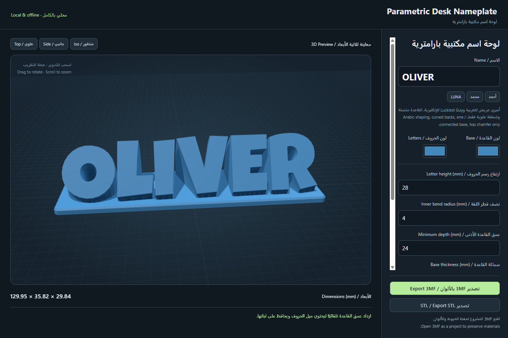

# لوحة اسم مكتبية بارامترية

[English](README.md) · [تحميل نسخة Windows](https://github.com/music-dj/parametric-desk-nameplate/releases/latest)

إنشاء لوحة اسم مكتبية بالعربية أو الإنكليزية. يتصل ظهر الحروف بالقاعدة بانحناء، والميل الافتراضي 33 درجة عن العمودي. يمكن تعديل ارتفاع الحروف ونصف قطر اللفة وعمق القاعدة الأدنى وسماكتها والشيمفر العلوي. لا يوجد شيمفر سفلي. الخط اللاتيني Luckiest Guy والعربي Amiri Bold مع تشكيل HarfBuzz واتجاه النص الصحيح.





## تشغيل البرنامج

1. نزّل ملف Windows ZIP من [الإصدارات](https://github.com/music-dj/parametric-desk-nameplate/releases/latest).
2. فك ضغط الملف بالكامل إلى مجلد عادي.
3. شغّل `ParametricDeskNameplate.exe` واترك بقية الملفات بجانبه.
4. اكتب الاسم وعدّل الإعدادات ودوّر المعاينة، ثم صدّر STL أو 3MF بالألوان.

البرنامج يعمل محلياً دون حساب أو إنترنت. النسخة محمولة وليست مثبتاً، وهي غير موقعة رقمياً.

## التصدير والأبعاد

الأبعاد بالملمتر. STL يحفظ الشكل فقط. 3MF يحفظ الأجزاء بألوانها، مع إعدادات خيوط Bambu Studio وOrcaSlicer. افتحه كمشروع وراجع توزيع الألوان. لا يرفق البرنامج بروفايل طابعة أو معايرة خيوط. تفسير الألوان يعتمد أيضاً على برنامج التقطيع. توجد نماذج مصدّرة في [examples](examples).

## الإعدادات

يتوفر حقل الاسم ومحددا اللون دائماً.

| الحقل | الوصف | الافتراضي |
| --- | --- | --- |
| `letterHeight` | ارتفاع رسم الحروف / Letter height (mm) | `28` |
| `bendRadius` | نصف قطر اللفة / Inner bend radius (mm) | `4` |
| `baseDepth` | عمق القاعدة الأدنى / Minimum depth (mm) | `24` |
| `baseThickness` | سماكة القاعدة / Base thickness (mm) | `3` |
| `tilt` | الميل عن العمودي / Tilt from vertical (°) | `33` |
| `topChamfer` | شطفة علوية / Top chamfer (mm) | `0.8` |

## الحدود والفحص

قد تكبر القاعدة تلقائياً عند زيادة الانحناء أو طول الاسم. راجع الأبعاد والثبات قبل الطباعة. اختُبرت التشكيلات العربية والنصوص المختلطة، وليس كل نص ممكن.

نجحت اختبارات الشبكات المغلقة والحجم الموجب والإدخال غير الصحيح والتصدير بصيغتي STL و3MF. اختُبرت الواجهة وتعديل القيم واستعادة الافتراضي، وكذلك نسخة EXE المجمعة. راجع [تقرير الهندسة](docs/geometry-test.json) و[تقرير الواجهة](docs/ui-test.json). لم تُنفذ طباعة فعلية؛ اطبع عينة قصيرة قبل الإنتاج.

## تشغيل السورس وبناء EXE

تحتاج Node.js 22 أو أحدث وnpm. نفّذ داخل مجلد المشروع:

```powershell
npm ci
npm start
npm test
npm run test:ui
npm run build:windows
```

ينتج البناء مجلداً محمولاً داخل `dist/parametric-desk-nameplate-windows`. احتفظ بكل محتوياته معاً.

## الحقوق

البرنامج مستقل، ولا يحتوي تابات المشاريع الأخرى. ترخيص كود التطبيق في [LICENSE](LICENSE)، مع استثناءات حقوق النماذج والأصول في [ATTRIBUTION.md](ATTRIBUTION.md). تراخيص الخطوط مرفقة داخل `assets`. 
