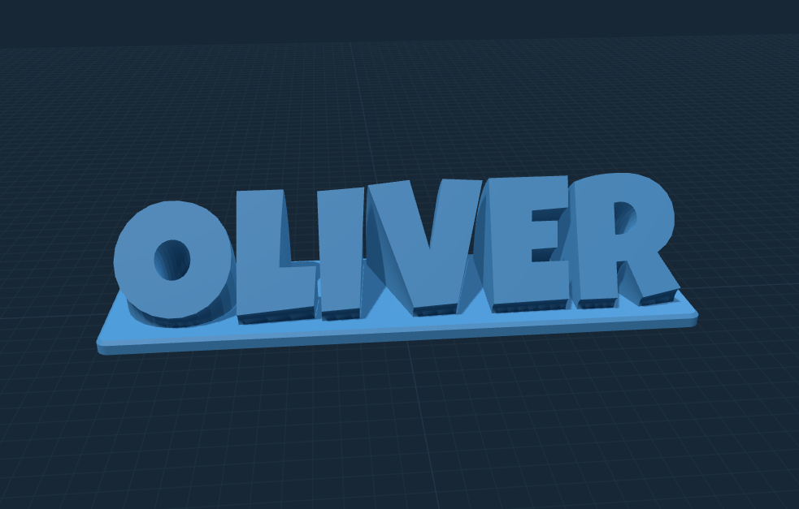
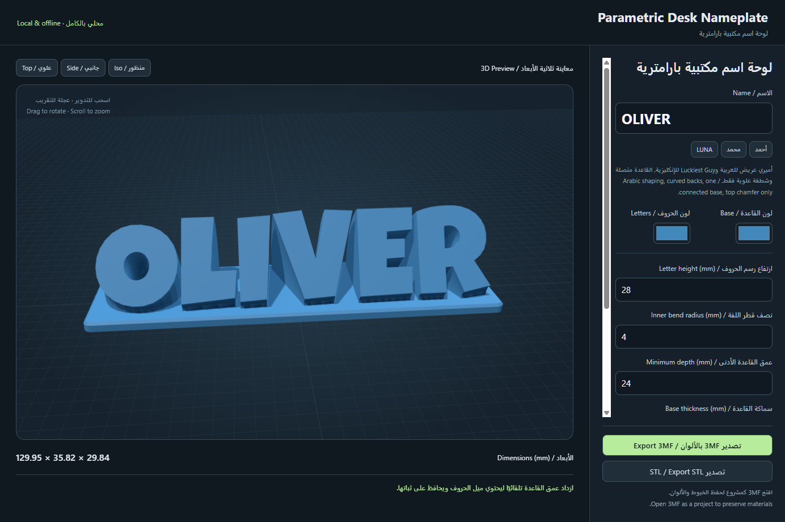

# Parametric Desk Nameplate

لوحة اسم مكتبية بارامترية

[العربية](README.ar.md) · [Download Windows EXE](https://github.com/music-dj/parametric-desk-nameplate/releases/latest)

Create an English or Arabic desk nameplate with letters connected to the base through a curved back. Default tilt is 33° from vertical. Adjust text height, inner bend radius, minimum base depth, base thickness, and upper chamfer. There is no lower chamfer. Latin uses Luckiest Guy; Arabic uses Amiri Bold with HarfBuzz shaping and bidirectional layout.





## Windows quick start

1. Download the Windows ZIP from [Releases](https://github.com/music-dj/parametric-desk-nameplate/releases/latest).
2. Extract the complete ZIP into a normal folder.
3. Run `ParametricDeskNameplate.exe`; keep its other files beside it.
4. Enter your name, adjust settings, rotate the preview, then export STL or colored 3MF.

Runs locally without an account or internet connection. This portable release is unsigned. It has no installer.

## Export

All dimensions are millimeters. STL contains geometry only. 3MF contains separately colored volumes plus Bambu Studio/OrcaSlicer filament metadata. Open 3MF as a project and review material assignments. Printer profiles and filament calibration are not supplied; slicers can interpret color metadata differently. Example files are in [examples](examples).

## Settings

Name and both color pickers are always available.

| Setting | Label | Default |
| --- | --- | --- |
| `letterHeight` | ارتفاع رسم الحروف / Letter height (mm) | `28` |
| `bendRadius` | نصف قطر اللفة / Inner bend radius (mm) | `4` |
| `baseDepth` | عمق القاعدة الأدنى / Minimum depth (mm) | `24` |
| `baseThickness` | سماكة القاعدة / Base thickness (mm) | `3` |
| `tilt` | الميل عن العمودي / Tilt from vertical (°) | `33` |
| `topChamfer` | شطفة علوية / Top chamfer (mm) | `0.8` |

## Limits

Deep bends or long names can enlarge the base automatically. Review dimensions and stability before printing. Arabic marks and mixed text are tested, but not every possible string.

## Run from source

Requires Node.js 22+ and npm.

```powershell
npm ci
npm start
```

## Test and package

```powershell
npm test
npm run test:ui
npm run build:windows
```
The build script creates a portable Windows folder in `dist/parametric-desk-nameplate-windows`. Set `ELECTRON_DIST` only when using an existing Electron runtime. Keep the complete output folder together.

Geometry checks cover 8 configurations, closed positive-volume meshes, invalid inputs, STL, and colored 3MF. UI checks cover initial load, fields, edits, reset, and both exports. The packaged Windows executable is also tested. Reports: [geometry](docs/geometry-test.json), [interface](docs/ui-test.json). Physical printing has not been tested.

## Source and attribution

The app is a standalone extraction of one generator from Keychain Studio. Only this generator is included; it has its own entry point and settings. Application code is covered by [LICENSE](LICENSE), subject to the exclusions and asset/model ownership in [ATTRIBUTION.md](ATTRIBUTION.md). Font licenses are included in `assets`. 
